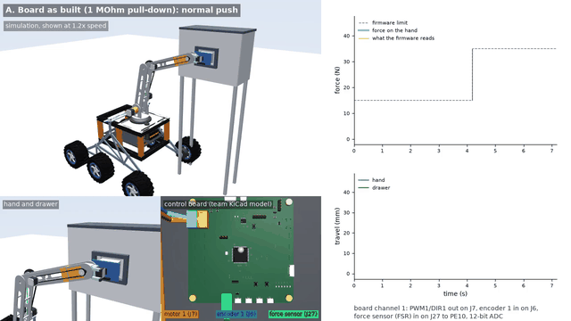

# Rover arm and control board: interface test in simulation

On our SSS (UC Davis Space and Satellite Systems) University Rover Challenge rover, the
control board (STM32G474) drives the arm's motor drivers with PWM and direction lines and
reads back encoders, limit switches and a resistive force sensor on the hand. This repo asks
how the real choices in that circuit (the force sensor's divider and filter, the ADC, where
the encoder sits, the drive, the bus) change the force the arm actually applies and what the
software side sees. Variables go in one at a time. The aim is a control interface for our
software team that behaves in simulation as close to the real board as we can make it.

The board's C firmware runs every millisecond against a 3-D MuJoCo model of the rover and
arm, and only sees what the board would: encoder counts and 12-bit ADC codes. Control is a
PI velocity loop with a force limit; over the limit it brakes and backs off 2 mm. No
machine learning, and nothing here has run on hardware.



*The arm's base turntable swings the hand to push a drawer shut. As built, the force reading
is mostly noise above a few newtons and the firmware trips before the drawer latches; with a
2.2 kOhm pull-down it follows the real force. Bottom middle: the board and the connectors
used. ([video](media/interface_test.mp4))*

## Variables so far

| Variable | Values tried | What it changes |
|---|---|---|
| Force sensor pull-down | 1 MOhm (both board revisions), 2.2 kOhm | counts per newton, false trips |
| Input filter | 10 nF (current board), 10 kOhm + 100 nF (September board) | input time constant |
| Force channel solver | hand formula; ngspice on the circuit cut from the team's schematic | whether the formula holds |
| ADC sampling capacitor | holds the last force sample; starts at 0 V (a grounded channel converted first) | reading offset, trip force |
| ADC noise | 1.5 counts RMS | how noisy the force reading is |
| Encoder mounting | motor shaft, turntable | counts per mm, speed estimate |
| Speed filter | 80 Hz, 5 Hz | speed error with the turntable encoder |
| Drive | current command, PWM and direction | trip force and timing |
| Wiring | as built, motor leads swapped, encoder swapped, both | whether the firmware notices |
| Force reading over a bus | 0, 1, 5, 10, 20 ms delay; 5 % dropped | force at the trip |
| Force reading over CAN, computed | sent every 1 to 20 ms; arm bus or shared with the drive motors; 500 k or 1 Mbit/s; FIFO read in the interrupt or once per tick | reading age, losses, force at the trip |
| Force ADC (server case) | ADS1220 at 1000/s, HX711 at 10/s | force overshoot |

## What it found

**1. The force input tells touch, not force.** The team's sheet says only "resistive", so the
numbers use an FSR 402-class datasheet curve. Both board revisions pull the sensor down with
1 MOhm, which puts the ADC input within a few counts of full scale above a few newtons:

| Force at the hand | 5 N | 15 N | 25 N | 35 N |
|---|---|---|---|---|
| ADC input, 1 MOhm pull-down | 3.286 V | 3.294 V | 3.296 V | 3.297 V |
| ADC counts per newton | 3.1 | 0.40 | 0.16 | 0.08 |
| ADC input, 2.2 kOhm | 1.10 V | 1.84 V | 2.18 V | 2.38 V |
| ADC counts per newton | 154 | 57 | 31 | 20 |

As built, the firmware tripped on a 41 N reading with 14 N real, before the drawer latched,
and against debris at 8 N. The September board's extra 10 kOhm and 100 nF only slow the input
to about 1 ms. With 2.2 kOhm the same firmware closes the drawer and trips at 15.0 N against
debris: a change to suggest at the next design review.

Solved instead by ngspice on the circuit cut out of the team's KiCad schematic, the channel
matches the formula within a microvolt and every case trips at the same force. It adds what
the formula left out, the STM32's 5 pF sampling capacitor: if the ADC converted a grounded
channel just before, the as-built reading drops 0.5 to 1.3 mV, under 2 counts, and the trip
moves from 13.8 to 17.6 N closing the drawer and from 8.4 to 10.5 N against debris. With
2.2 kOhm nothing changes. On the as-built board the ADC scan order would have to be part of
the interface.

**2. Where the encoder sits matters.** A REV encoder (8192 counts per revolution) on the motor
gives 214 counts per mm at the hand; on the turntable only 2.1, and the 1 kHz speed estimate
jumps to 156 mm/s while the hand moves at 10 to 30 mm/s (a 5 Hz filter cuts the error from 29
to 4.5 mm/s RMS).

**3. A pin-plan question for the team.** If encoders 1 to 4 all use timer encoder mode, PWM3
and PWM4 have no hardware timer left (encoder 1 needs TIM3, so encoder 3 takes TIM20, and
encoder 4 needs TIM1); one encoder could be decoded from pin interrupts instead. The same check
finds the TIM4 clash between encoder 4 and PWM5 on the September board.

**4. A wiring check catches one swap, not two.** With motor leads or encoder A/B swapped, the
firmware trips with a wiring fault within 0.16 s. With both swapped the loop looks healthy and
the hand travels 52 mm the wrong way. Homing on a limit switch zeroes within 0.06 mm at 5 mm/s
(0.26 mm at 20 mm/s); with both swapped it runs away from the switch until the force limit or
a search limit stops it, so the search limit must fit the free travel.

**5. Limit the force on the board that reads it.** In the team's multi-board plan the force
sensor sits on an end-effector node and its reading crosses a second CAN bus:

| Delay of the force reading | 0 | 5 ms | 10 ms | 20 ms |
|---|---|---|---|---|
| Arm: real force at the trip | 15.0 N | 15.0 N | 15.0 N | 15.1 N |
| Server case: peak force | 103 N | 109 N | 126 N | 182 N |

At the arm the force rises about 6 N/s, so 20 ms barely matters; the 25 kg server gains
several newtons per millisecond (5 % dropped frames on top of 10 ms changed nothing in this
run). The limit check belongs on the board that reads the sensor,
with the software setting the limit through the interface.

The delays above were typed in. A CAN model now computes them: real frames bit by bit with
stuffing, arbitration, the STM32G4's three transmit buffers and three-deep receive FIFOs, and a
proposed message table for the arm bus. A force frame is on the wire for 66 us at 1 Mbit/s and
waits at most 0.12 ms for the bus (up to 1.7 ms behind the drive motors' bursts with a
low-priority ID on a shared bus), so the reading's age is set by how often the node sends it:
about half the send period on average and up to the whole period. The arm still trips at 15.0 to 15.1 N; the
server peaks at 104 N sending every 1 ms and 167 N every 20 ms. Two interface rules come out:
the firmware's 5 ms stale-reading timeout faults the arm at 38 ms if the node sends every
10 ms, so the timeout must follow the send period; and on a shared bus a main board that reads
its receive FIFO once per 1 ms tick loses motor replies, so it should read it in the interrupt.

## How it is simulated

- MuJoCo at 10 kHz; the firmware at 1 kHz through a thin HAL, the same sources that compile for
  the Cortex-M4F, with a UART client for commands and telemetry. Pin tables and the timer check
  are in [docs/BOARD_INTERFACE.md](docs/BOARD_INTERFACE.md); numbers in `results/3d/`.
- The force channel can be solved by ngspice every millisecond: `board/extract_fsr.py` cuts it
  out of the schematic's netlist into `board/fsr_front_<rev>.cir`, and the STM32 pin (5 pF,
  640.5-cycle sampling, leakage) follows the datasheet. About 1.5 s per simulated second.
- The arm uses the team's design-sheet lengths and masses; only the base turntable (a DC channel)
  moves. The force climbs about 6 N/s against debris (the PI integral adds 1.2 A/s and each amp
  gives about 5.3 N at the hand); the base can push at most about 68 N.
- For the arm the firmware's "closed" window is -3 to +2 mm around the drawer stop (-2 to +2
  on the linear axis): the hand swings on an arc, so the pad meets the drawer edge first and
  the position estimate reads about 1.2 mm short.
- Case B, a 25 kg server pushed into a rack on a linear axis, is one I added for data-centre
  style tasks. It matches my earlier 1-D model because it applies the same force laws.

```
python -m pip install -r requirements.txt
python build.py                      # firmware DLL and Cortex-M4F compile check
python -m sim3d.cases out/           # all cases: traces, replays, summary.json
python sim3d/render.py . out/ media/ # replay video
python -m pytest -q
```

## Limits

- Simulation only; nothing has run on the board, the arm or other hardware.
- Arm lengths are from the design sheet before the arm was shortened; the pose is read off a
  CAD picture. Which board channel drives which joint is assumed.
- Assumed: base motor values (sized to the sheet's 550 kg cm motor), the FSR part and curve
  (no hysteresis), ADC noise, the ADC clock and switch resistance,
  the encoder mounting, the drawer forces and the limits. The 1 MOhm pull-down may be meant
  for touch detection only.
- The CAN model has no clock drift or interrupt latency, and the arm's message table and the
  motors' 0.1 ms reply time are assumed. The arm's drive side has no CAN bus yet; the [drivebase simulation](https://github.com/ChenSiyun1234/JOVER/tree/drivebase-sim/drivebase_sim)
  models CAN command delay and dropped frames.
- The rover and the arm are the SSS team's design; I worked on the control board with the team.
