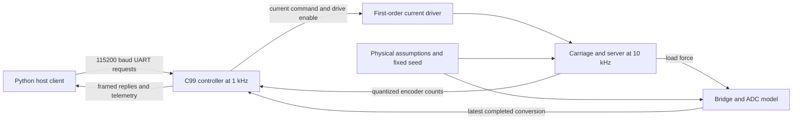
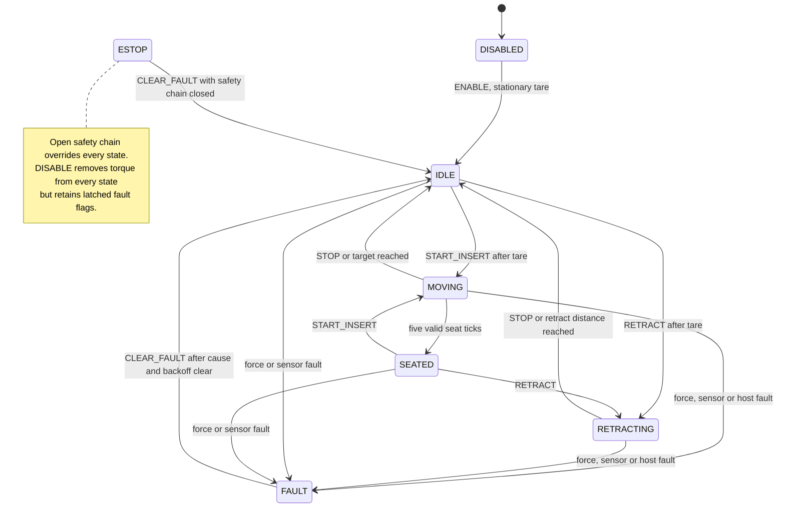

# Design: a force-limited insertion axis

This project tests a controller that pushes a server along rails into a rack
connector. The fast approach must distinguish normal rail resistance from a jam;
the final insertion must tolerate connector force and stop at a seated position.
A load cell measures pusher force, while a screw encoder measures carriage travel.
All results here are software-in-the-loop (SIL), not hardware measurements.

## Reading the loop

The controller is ordinary C99 with no register access, dynamic allocation or
libc calls. Only stdint.h, stdbool.h and stddef.h are included. The Windows DLL
and Cortex-M4F compile check use the same six C sources. The MCU build excludes
the DLL-only reference-injection hook used for the velocity experiment.

At each millisecond, Python advances ten 0.1 ms mechanical and sensor steps.
The firmware consumes the newest conversion and encoder count, executes one
control tick and sets the next current command. UART delivery follows the tick.
At 115200 baud with 8N1 framing, each direction can deliver 11.52 bytes/ms.
Fractional credit carries forward; unused whole-byte credit does not fund bursts.

The single static controller context is owned by axis.c. It contains named
parameters, telemetry and motion state. force_guard.c owns sensor protection;
commands.c owns command eligibility; protocol.c owns framing and bounded buffers;
parameters.c owns the sole C parameter metadata table; crc16.c owns the checksum.
The Python host has its own independent codec and parameter-ID table.
All calls must be serialized; a second Firmware or Sim resets the same DLL instance.

## Motion states

ENABLE or TARE collects 50 stationary conversions. Motion waits for completion.
The reference approaches at 100 mm/s, then requests 10 mm/s once estimated
server position reaches 270 mm. Acceleration is limited to 500 mm/s^2.
Stopping-distance logic also slows the reference for the commanded target.
A bounded outer position correction holds IDLE and the completed fault backoff.

Seating requires estimated server position between 293 and 297 mm and measured
force at least 110 N for five consecutive ticks. SEATED requests zero current.
The nominal experiment ends on that tick: it does not simulate a mechanical
latch or prove that a torque-free server will stay seated.

## Force protection, step by step

1. On a fresh conversion, divide the signed ADC code by counts/N and subtract
   the stationary tare offset. ADC zero is valid; either saturation endpoint
   latches SENSOR_RANGE. Missing conversions latch SENSOR_STALE after the
   configured stale budget.
2. Apply the optional first-order low-pass. Its coefficient is
   alpha/(1+alpha), where alpha = 2*pi*cutoff*elapsed_sample_time. A cutoff of
   zero bypasses filtering. Trips use this measured force because true plant
   force is unavailable to a physical controller. Filtering reduces noise but
   adds detection delay.
3. Estimate server position as carriage_mm - force_N / pusher_stiffness_N_per_mm.
   Compression explains why carriage travel alone is not server travel. This
   estimate ignores contact damping and depends on correct stiffness calibration.
4. Select a 60 N limit below 278 mm and 150 N thereafter. The higher limit allows
   normal connector engagement; applying it over the whole rail delays jam
   detection. Turning the envelope off uses 150 N everywhere.
5. On force above the active limit, latch OVERFORCE and record detection force
   and absolute fault time. Reset the PI integral and immediately request zero
   velocity with the full current clamp available for braking. Inertia can
   increase true force after the trip.
6. Once measured speed is below 2 mm/s, reverse toward a point 2 mm behind the
   fault carriage position at 10 mm/s, then hold in FAULT. Backoff releases
   stored spring compression. A fixed distance does not guarantee zero force:
   the baseline global-threshold jam retains 32.430 N after 1.5 s.

Sensor faults and host timeout request zero velocity with active braking, without
automatic backoff. The communication watchdog runs only in MOVING or RETRACTING:
idle holding does not require a stream of host messages. Every valid-CRC frame
refreshes it, including a NACKed command. E-stop removes drive enable on its tick
independently of the ADC. CLEAR_FAULT requires a closed chain, fresh in-range
sensor, force below the current limit and completed backoff. DISABLE retains
fault flags, so it cannot bypass a latched fault through ENABLE.

The parser silently drops bad frames because a corrupted command and sequence
number cannot be trusted for a reply. It rescans buffered bytes after CRC failure,
rejects payloads over 64 bytes and expires incomplete frames after 20 ms.
Whole replies are dropped when the fixed TX queue is full. See
[INTERFACE.md](INTERFACE.md) for frame layouts and test-checked hex examples.

The pusher force is the unilateral contact force between carriage and server,
measured by the load cell. The rack force reported for a jam is the unilateral
jam-spring force between server and rack. Server momentum and rebound can make
these forces differ; the firmware senses only pusher force and can command the
carriage in response, so it cannot directly measure or limit rack force.

## Mechanical and sensor assumptions

The carriage effective mass is M_c = m_carriage + J_rotor*(2*pi/lead)^2.
Motor force is I*Kt*2*pi*efficiency/lead, preceded by a 0.5 ms current lag.
A unilateral spring and damper couple the carriage and server: separation
transmits no force. Damper sizing uses the reduced two-mass inertia.
Carriage drag is smoothed Coulomb plus viscous friction. Server rails use
static sticking and sliding Coulomb friction.

Connector resistance rises over 280..290 mm to 90 N, then holds at 60 N.
An end stop adds 500 N/mm beyond 295 mm. A jam adds a 100 N/mm obstruction
spring beyond its configured position. Bridge sensitivity is 2 mV/V at 500 N
with 5 V excitation. Structural vibration is added at 10 kHz, then averaged by
the converter model; electrical Gaussian noise is added per conversion.

The rectangular ADC averaging windows approximate latency; they are not exact
digital filter impulse responses. HX711's four-period settling time applies
after startup, reset or channel/gain changes. Using it as a continuous moving
window is an explicit modeling assumption, so the HX711 comparisons are
sensitivity studies, not measured converter behavior. ADS1220 uses an assumed
single-cycle window. The datasheet noise values are typical under their stated
conditions and do not guarantee the assumed bridge circuit's electrical noise.

| Model | Rate (SPS) | Window (ms) | RMS input noise (uV) | Source |
|---|---:|---:|---:|---|
| HX711_10 | 10 | 400 | 0.05 | HX711 datasheet p3 and settling footnote |
| HX711_80 | 80 | 50 | 0.09 | HX711 datasheet p3 and settling footnote |
| ADS1220_330 | 330 | 3.030 | 0.34 | ADS1220 Table 7-1, section 8.3.6 |
| ADS1220_1000 | 1000 | 1 | 0.70 | ADS1220 Table 7-1, section 8.3.6 |
| ADS1220_2000 | 2000 | 0.5 | 0.82 | ADS1220 Table 7-5, section 8.3.6 |
| IDEAL_1000 | 1000 | 0 | 0 | Synthetic reference; not a real part |

Sources: [HX711 datasheet](https://cdn.sparkfun.com/assets/0/2/7/d/1/HX711_datasheet.pdf),
[ADS1220 datasheet](https://www.ti.com/lit/ds/symlink/ads1220.pdf).
Physical source comments are maintained in sim/params.py; firmware metadata is
in host/axis_client/parameters.py and firmware/src/parameters.c.

IDEAL_1000 samples true force at 1000 SPS without vibration, electrical noise or
averaging. It still uses the integer ADC interface (less than 0.0001 N rounding)
and the 1 kHz firmware scheduler. At 2000 SPS the firmware receives only the
newest of two conversions per tick, so it consumes at most 1000 updates/s.
The host configures stale timeout as max(5, ceil(3000/rate)) ms.

## Velocity loop tuning

For a moving server, include the carried load in the low-frequency inertia:

- Reflected rotor mass = J (2 pi / lead)^2 = 1.2e-5 (2 pi / 0.010)^2
  = 4.737 kg.
- Moving mass M = 6 kg carriage + 4.737 kg rotor equivalent + 25 kg server
  = 35.737 kg. The pusher drives the server during travel.
- Force per amp K_F = Kt 2 pi efficiency / lead
  = 0.1 * 2 pi * 0.9 / 0.010 = 56.549 N/A.

The rigid approximation is G(s) = K_F / (M s + 50) in m/s per amp.
With C(s) = Kp + Ki/s its denominator is
M s^2 + (50 + K_F Kp) s + K_F Ki. Convert firmware gains from mm to m:
Kp = 0.035 A/(mm/s) = 35 A/(m/s); old Ki = 0.8 A/mm = 800 A/m,
new Ki = 0.12 A/mm = 120 A/m. The rigid natural frequency drops from
35.58 to 13.78 rad/s and damping ratio rises from 0.798 to 2.060.
The PI numerator zero also affects command overshoot, so these denominator
values alone do not predict the measured response. Lower integral gain reduces
integral buildup and spring excitation; proportional gain remains unchanged.

The 80 Hz velocity filter suppresses differentiated encoder quantization. Its
backward-Euler coefficient is a/(1+a), a = 2 pi * 80 * 0.001, or 0.3345.
Its continuous approximation adds about 7.1 degrees of lag at 10 Hz and has
a 1.99 ms time constant. It stays in the probe loop, together with the 0.5 ms
driver lag, two-mass contact and safety checks. It is distinct from E4's force
filter. Raising gains against the rigid approximation alone can excite the
contact mode and amplify encoder ripple.

The DLL-only reference probe applies the same 50-to-60 mm/s free-travel step.
Cruise preparation is now 3 s rather than 1.5 s so the lower integral gain
settles near 50 mm/s; the response window remains 500 ms. A subsequent 10 mm/s
reference runs for 2 s. The server stays below connector entry at 280 mm.
For comparison, rerunning the previous gains with the same 3 s preparation
gives 30 ms, 11.667 Hz and 29.841% measured overshoot (28.663% true).
Thus the overshoot reduction persists with identical preparation timing.
Rise time uses 51 and 59 mm/s thresholds; bandwidth is 0.35 / rise time,
rounded to avoid floating-point subtraction making exactly 10 Hz appear below
10 Hz. This is one operating-point estimate, not a frequency sweep.
[velocity.csv](../results/velocity.csv) records measured and true-speed metrics.
The slower 0-to-2 mm/s regression now observes 6 s to include friction breakaway;
it is not the cruising bandwidth estimate.

