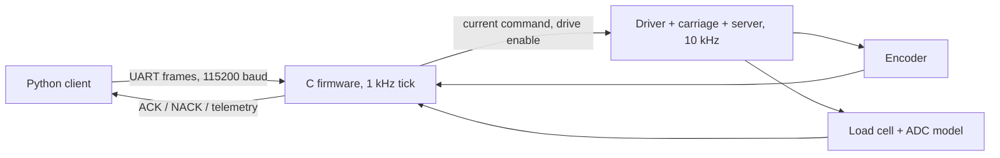
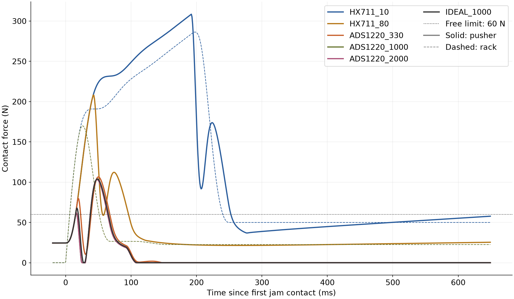
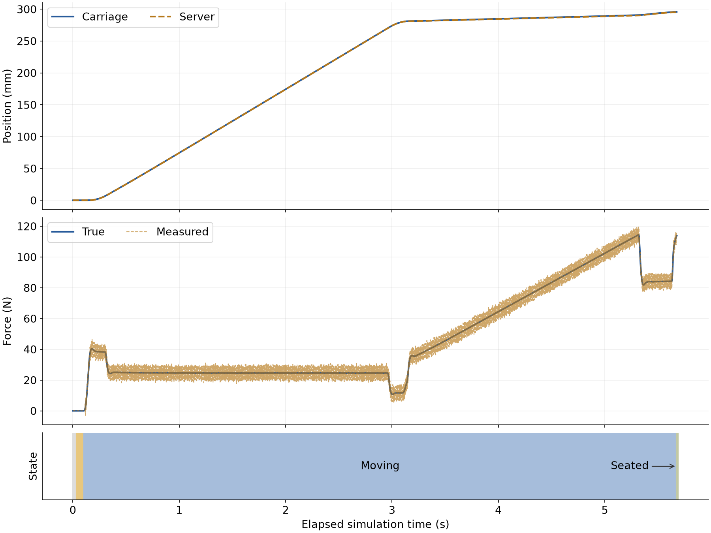

# Findings

The detailed results from the simulation. The README has the short version; the tables are generated into [RESULTS.md](RESULTS.md) by `experiments/run_all.py`.

## How the pieces connect

## Results

### 1. Sensor speed matters at low approach speed; momentum sets the force above it

A jam at 150 mm into the rails, with a 60 N limit for free travel. The peak
**pusher** force is what the load cell sees. The peak **rack** force is what the
server and the rail feel.

| Approach speed | HX711 at 10 SPS, pusher / rack | ADS1220 at 1 kSPS, pusher / rack | Ideal sensor, rack |
|---|---|---|---|
| 25 mm/s | 114 N / 90 N | 61 N / 48 N | 48 N |
| 50 mm/s | 166 N / 142 N | 61 N / 90 N | 91 N |
| 100 mm/s | 308 N / 286 N | 103 N / 170 N | 172 N |
| 200 mm/s | 438 N / 409 N | 212 N / 327 N | 327 N |

- **The HX711 is too slow for this job.** Modeled as averaging over its four-conversion
  settling time, at 10 SPS its reading lags about 200 ms. Before it trips, the force
  is past the 60 N limit at every tested speed: 114 N at 25 mm/s, 308 N at 100 mm/s.
- **A 1 kSPS ADS1220 is as good as an ideal sensor.** Its rack force stays within
  2% of the ideal sensor's at all four tested speeds. From 50 mm/s up, the ideal sensor
  lets the rack force pass the limit (91 N at 50 mm/s). The server's own momentum goes into the
  jam, and after the trip the pusher brakes away from the server, which then
  rebounds. A simple estimate, `v * sqrt(k_jam * m_server)`, gives 79 N at
  50 mm/s and 158 N at 100 mm/s.
- **The design rule:** wherever a jam is possible, the approach speed is the real
  force limit. A faster ADC is not.

### 2. A force limit that depends on position

During free travel along the rails, the limit is 60 N. It rises to 150 N only
where the connectors are expected to mate. At the 150 mm jam with the ADS1220 at
100 mm/s:

- **Position-dependent limit:** trips at 62.5 N. After the 2 mm back-off, the
  sample 1.5 s after detection shows 0 N left on the server.
- **One global 150 N limit:** trips at 152.1 N. The sample 1.5 s after detection
  still shows 19.7 N.

### 3. A softer pusher protects the pusher, not the rack

At 100 mm/s with the ADS1220:

- Going from a 200 N/mm pusher to a 5 N/mm pusher cuts the jam's pusher force
  from 103 N to 58 N.
- The rack force barely changes, 169 N to 162 N, because it comes from the
  server's own momentum.
- At 5 N/mm the firmware can no longer confirm seating. Its server position
  estimate, `carriage - force / k`, ran about a millimetre ahead of the real
  server, so the axis stopped at 294.8 mm, short of the 295 mm end stop.
- 20 N/mm still seats.

### 4. Filtering the force: margin against delay

With no filter, the largest force seen during free travel across 20 noisy runs was
46.5 N, against the 60 N limit. A 20 Hz low-pass lowers that to 40.4 N. The cost:
it trips 6.9 ms after the true force crosses 60 N (unfiltered, the noisy reading
trips before that crossing), and the jam's pusher peak rises from 103.2 N to 110.1 N. The default is no filter.

### 5. Nominal insertion and the velocity loop

A nominal insertion seats at 295.1 mm in 5.58 s: 2.86 s of fast approach, then
2.72 s at 10 mm/s. The peak force is 114.5 N against the end stop.

The velocity PI was checked with a 50 to 60 mm/s step while cruising. The first
check, a step from rest, mostly measured breakaway friction and the integrator,
not the loop. The cruising step gives a 35 ms rise time (about 10 Hz) and 8.9%
overshoot.

### 6. 24 V I/O front end ([hw/](../hw/README.md))

**Isolated 24 V input** (optocoupler, sized for IEC 61131-2 Type 3):

- Across 128 tolerance corners it is always ON at 9.96 V and above, and always
  OFF at 6.90 V and below.
- It draws 3.45 to 3.89 mA at 11 V.
- The cost is heat: 0.26 W per channel at 24 V. An integrated, current-limited
  receiver such as the ISO1211 draws about 0.054 W, so a board with many channels
  should use one.

**Holding-brake coil driver** (assumed 72 ohm, 0.6 H coil):

- With a plain flyback diode, the coil current takes 9.43 ms to fall to drop-out.
- A TVS clamp across the coil cuts that to 3.16 ms, and one across the MOSFET to
  3.34 ms.
- The drain peaks at 57.1 V on a 100 V MOSFET.

## Layout

| Path | What it holds |
|---|---|
| `firmware/include/axis_fw.h` | Public API: inputs, outputs, states, faults, commands, parameter ids |
| `firmware/src/axis.c`, `force_guard.c` | Motion, velocity PI, tare, force limit, fault checks |
| `firmware/src/commands.c`, `protocol.c`, `crc16.c` | Command handling, framing, CRC |
| `firmware/src/parameters.c`, `constants.h` | Parameter table with ranges and locks, fixed constants |
| `host/axis_client/` | Python codec and client |
| `sim/` | Plant, sensors and the SIL runner |
| `experiments/`, `results/` | Experiment code and its output |
| `docs/` | Design, interface spec, results |
| `hw/` | 24 V input and brake driver: netlists, schematics, results |

## Limits and next steps

- **Assumed values:** the mechanics, friction, connector force, vibration and
  brake coil are assumed. The next step is to measure them on a real axis and
  re-run the experiments.
- **No firmware image yet:** the ARM build is a compile check. The next steps are
  a HAL on the STM32G474 (timer encoder, SPI to the ADS1220, PWM to the driver),
  then hardware-in-the-loop with a real load cell and ADC.
- **Protocol:** the protocol has no command de-duplication, so a retried command
  runs twice. Next would be idempotent sequence numbers, and a CAN or RS-485
  transport for the machine.
- **Velocity loop:** the lower integral gain slowed the 10 mm/s insert phase.
  Friction feed-forward would win that time back without the overshoot.
- **Back-off:** the fixed 2 mm back-off can leave force on the server after a
  global-limit trip. Backing off until the force reads zero would be better.
