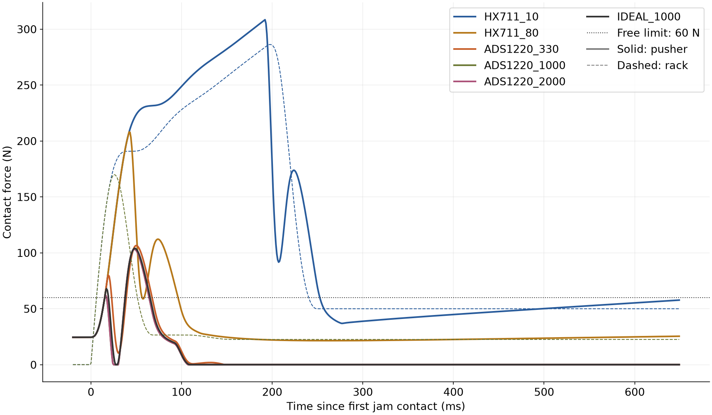
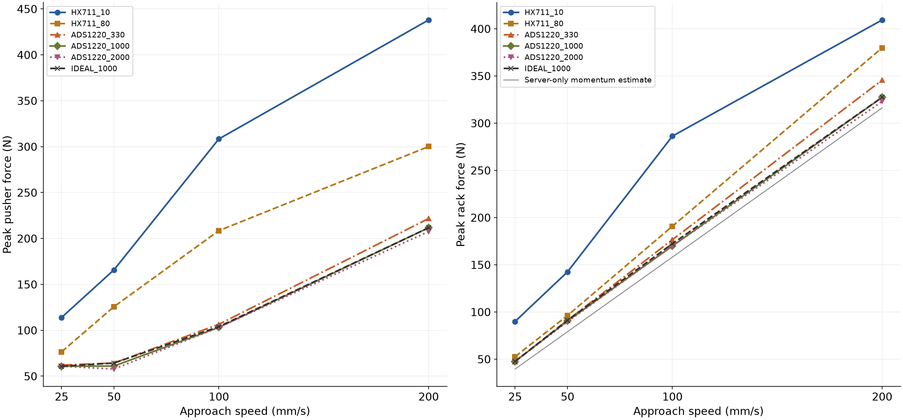
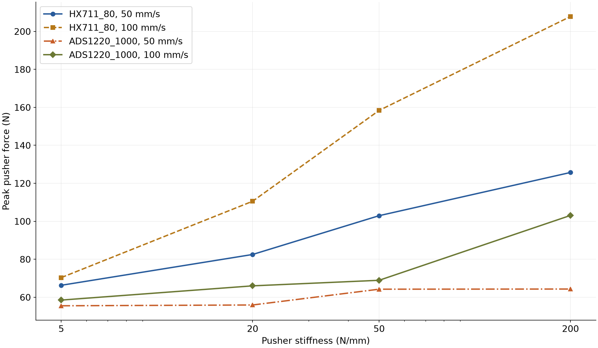
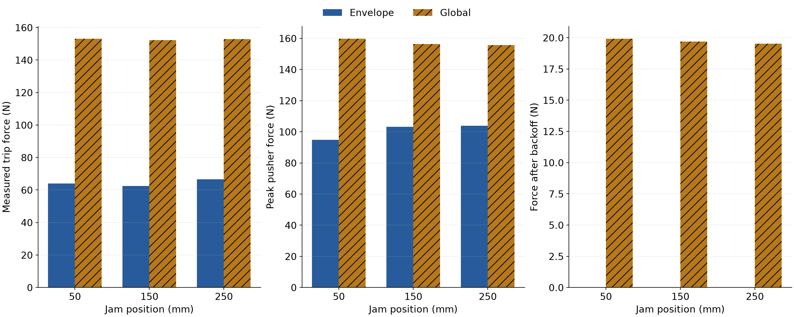
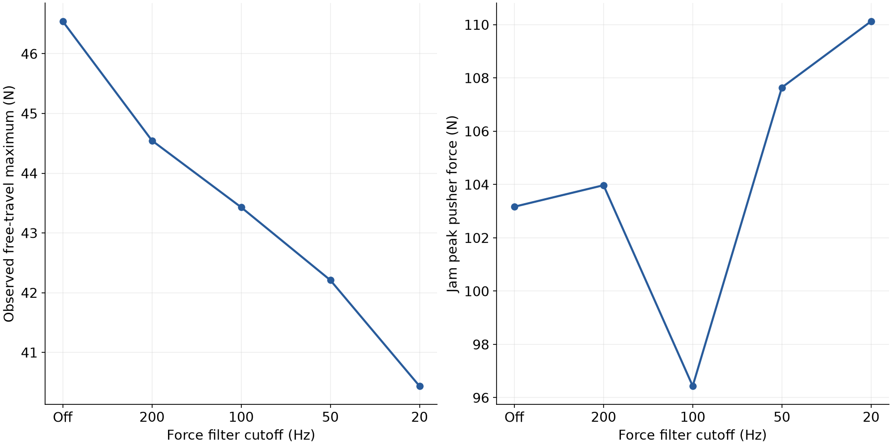
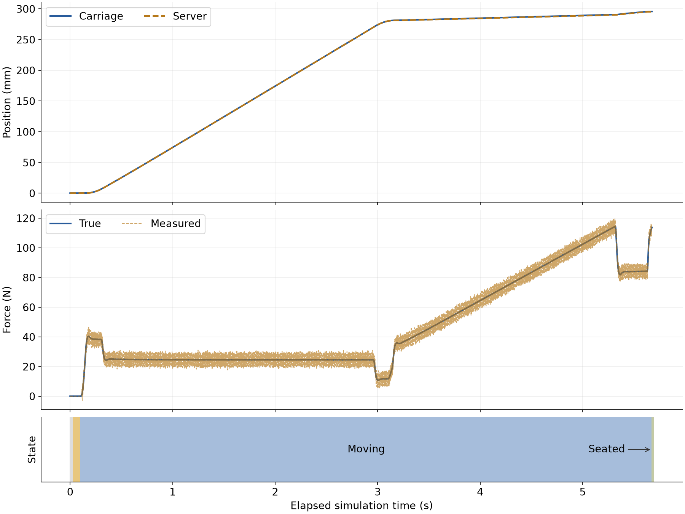

# Simulation results

Generated by `experiments/run_all.py`. Regenerate from the repository root with
`python build.py` followed by `python experiments/run_all.py`.

These are **simulation results, not hardware measurements**. The parameters in
[DESIGN.md](DESIGN.md) include assumed mechanics, friction, contact, current-loop
and vibration values. ADC averaging is an approximation, especially for HX711.
`IDEAL_1000` is a synthetic reference, not a real part.

All sweeps use seed 42 except E4's 20 nominal runs per cutoff (seeds 42 through 61).
CSV files retain full precision. Jam peaks include 1.5 s after detection, including
braking and backoff, and are measured at 10 kHz; detection uses the firmware's
filtered measurement at 1 kHz. Pusher force is the load-cell contact force; rack force is the jam spring force. Delay starts at the first true 60 N pusher-force crossing
(150 N for the global-threshold E3 cases); this crossing has 0.1 ms resolution
with the envelope and 1 ms for E3 global cases. A delay of n/a means the noisy
measurement tripped before true force ever crossed the threshold. Backoff force is the final sample
after that 1.5 s, not a guaranteed steady-state unload.

## E1: Sensor latency and approach speed

Jam at 150 mm, pusher 200 N/mm, envelope enabled, 60 N free limit.
The current-limit column means actual driver current reached 99.9% of 8 A before
trip. The peak regime uses actual and commanded current at the sampled force peak;
"current-limited stall" requires both to be at least 7.99 A. Available static
pusher force is 442.389 N (8 A motor force minus 10 N carriage friction); transient
inertial peaks may exceed it.

| ADC | Speed (mm/s) | Measured trip (N) | True trip (N) | Delay (ms) | Peak pusher force (N) | Peak rack force (N) | Current limit before trip | Peak regime |
|---|---|---|---|---|---|---|---|---|
| HX711_10 | 25 | 72.667 | 113.929 | 278.200 | 113.929 | 89.938 | no | transient / protection |
| HX711_10 | 50 | 72.331 | 165.831 | 168.800 | 165.831 | 142.463 | no | transient / protection |
| HX711_10 | 100 | 121.703 | 308.399 | 176.900 | 308.399 | 286.253 | no | transient / protection |
| HX711_10 | 200 | 67.128 | 437.584 | 56.800 | 437.980 | 409.317 | yes | transient / protection |
| HX711_80 | 25 | 69.252 | 76.467 | 41.200 | 76.536 | 52.660 | no | transient / protection |
| HX711_80 | 50 | 77.293 | 125.708 | 31.800 | 125.718 | 96.218 | no | transient / protection |
| HX711_80 | 100 | 90.577 | 207.971 | 26.900 | 208.516 | 190.785 | no | transient / protection |
| HX711_80 | 200 | 82.236 | 294.004 | 19.800 | 300.090 | 379.807 | no | transient / protection |
| ADS1220_330 | 25 | 60.881 | 61.741 | 1.200 | 62.107 | 47.621 | no | transient / protection |
| ADS1220_330 | 50 | 60.136 | 62.666 | 0.800 | 64.339 | 91.194 | no | transient / protection |
| ADS1220_330 | 100 | 67.349 | 76.702 | 2.900 | 106.509 | 176.515 | no | transient / protection |
| ADS1220_330 | 200 | 78.073 | 105.967 | 4.800 | 221.698 | 345.615 | no | transient / protection |
| ADS1220_1000 | 25 | 61.426 | 60.401 | 0.200 | 60.805 | 47.567 | no | transient / protection |
| ADS1220_1000 | 50 | 60.273 | 59.394 | n/a | 61.049 | 90.457 | no | transient / protection |
| ADS1220_1000 | 100 | 62.525 | 59.630 | n/a | 103.167 | 169.881 | no | transient / protection |
| ADS1220_1000 | 200 | 67.365 | 66.516 | 0.800 | 211.638 | 327.337 | no | transient / protection |
| ADS1220_2000 | 25 | 63.231 | 60.401 | 0.200 | 60.805 | 47.567 | no | transient / protection |
| ADS1220_2000 | 50 | 60.262 | 56.164 | n/a | 57.774 | 89.636 | no | transient / protection |
| ADS1220_2000 | 100 | 62.299 | 59.630 | n/a | 103.167 | 169.881 | no | transient / protection |
| ADS1220_2000 | 200 | 61.281 | 58.549 | n/a | 207.585 | 323.043 | no | transient / protection |
| IDEAL_1000 | 25 | 60.401 | 60.401 | 0.200 | 60.805 | 47.567 | no | transient / protection |
| IDEAL_1000 | 50 | 62.666 | 62.666 | 0.800 | 64.339 | 91.194 | no | transient / protection |
| IDEAL_1000 | 100 | 65.048 | 65.048 | 0.900 | 103.973 | 172.269 | no | transient / protection |
| IDEAL_1000 | 200 | 66.516 | 66.516 | 0.800 | 211.638 | 327.337 | no | transient / protection |

Rack peaks by speed (25 mm/s: ideal 47.6 N, ADS1220_1000 47.6 N, HX711_10 89.9 N; 50 mm/s: ideal 91.2 N, ADS1220_1000 90.5 N, HX711_10 142.5 N; 100 mm/s: ideal 172.3 N, ADS1220_1000 169.9 N, HX711_10 286.3 N; 200 mm/s: ideal 327.3 N, ADS1220_1000 327.3 N, HX711_10 409.3 N).

For HX711_10, latency raises the rack peak well above the ideal at all four speeds (25, 50, 100 and 200 mm/s). For ADS1220_1000 and ADS1220_2000, the rack peak is within 2% of the ideal at every tested speed; server momentum sets the peak in these cases, so a faster ADC cannot materially reduce it under these conditions. The requested speed can differ from the actual speed at contact.

The reference F = v sqrt(k_jam m_server) is the peak force if the server alone ran into the jam spring at that speed, with no pusher: 25 mm/s: 39.5 N, 50 mm/s: 79.1 N, 100 mm/s: 158.1 N, 200 mm/s: 316.2 N.

At 100 mm/s, HX711_10 has a trip delay of 176.9 ms and the peak pusher force is
308.4 N, compared with n/a and
103.2 N for ADS1220_1000. An n/a delay means the measured force tripped before a true 60 N crossing.
HX711_10 no longer reaches the current limit at this speed with the retuned PI.
The table identifies any saturated-drive cases at the other speeds.

## E2: Pusher compliance

Same jam, with firmware stiffness matched to the mechanical pusher in every run.
All E2 jam cases use 50 mm/s^2 acceleration so compliant pushers reach the jam;
nominal cases use both 500 and 50 mm/s^2 to expose the acceleration trade-off.
The CSV records the acceleration; the requested approach speed is unchanged.

| Stiffness (N/mm) | ADC | Speed (mm/s) | Peak pusher force (N) | Peak rack force (N) |
|---|---|---|---|---|
| 200 | HX711_80 | 50 | 125.698 | 96.233 |
| 200 | HX711_80 | 100 | 207.825 | 190.978 |
| 200 | ADS1220_1000 | 50 | 64.305 | 91.204 |
| 200 | ADS1220_1000 | 100 | 103.069 | 169.233 |
| 50 | HX711_80 | 50 | 102.939 | 82.725 |
| 50 | HX711_80 | 100 | 158.368 | 165.587 |
| 50 | ADS1220_1000 | 50 | 64.223 | 82.725 |
| 50 | ADS1220_1000 | 100 | 68.911 | 165.562 |
| 20 | HX711_80 | 50 | 82.505 | 80.624 |
| 20 | HX711_80 | 100 | 110.531 | 161.369 |
| 20 | ADS1220_1000 | 50 | 55.908 | 80.624 |
| 20 | ADS1220_1000 | 100 | 65.988 | 161.369 |
| 5 | HX711_80 | 50 | 66.282 | 79.339 |
| 5 | HX711_80 | 100 | 70.329 | 162.488 |
| 5 | ADS1220_1000 | 50 | 55.490 | 79.339 |
| 5 | ADS1220_1000 | 100 | 58.494 | 162.488 |

Nominal insertion with ADS1220_1000 at each stiffness:

| Stiffness (N/mm) | Acceleration (mm/s^2) | Server resonance (Hz) | Two-mass damping ratio | Server-mode damping ratio | Seated | Final state | Fault flag | Free maximum (N) | Final server (mm) | Cycle (s) |
|---|---|---|---|---|---|---|---|---|---|---|
| 200 | 500 | 14.235 | 0.050 | 0.027 | yes | SEATED | NONE | 46.542 | 295.099 | 5.575 |
| 200 | 50 | 14.235 | 0.050 | 0.027 | yes | SEATED | NONE | 32.307 | 295.099 | 5.829 |
| 50 | 500 | 7.118 | 0.050 | 0.027 | yes | SEATED | NONE | 53.118 | 295.096 | 5.749 |
| 50 | 50 | 7.118 | 0.050 | 0.027 | yes | SEATED | NONE | 34.087 | 295.096 | 6.009 |
| 20 | 500 | 4.502 | 0.050 | 0.027 | yes | SEATED | NONE | 57.178 | 295.068 | 6.062 |
| 20 | 50 | 4.502 | 0.050 | 0.027 | yes | SEATED | NONE | 35.337 | 295.067 | 6.309 |
| 5 | 500 | 2.251 | 0.050 | 0.027 | no | IDLE | NONE | 56.194 | 294.816 | 7.124 |
| 5 | 50 | 2.251 | 0.050 | 0.027 | no | IDLE | NONE | 38.434 | 294.951 | 7.356 |

At 100 mm/s with ADS1220_1000, the peak pusher force with the 5 N/mm pusher is
58.5 N versus 103.1 N for 200 N/mm.
The resonance column uses f = sqrt(k / m_server) / (2 pi), with k in N/m
and m_server = 25 kg. The contact damper is set to 0.05 of critical damping
for the reduced two-mass system; its equivalent server-only damping ratio is
shown separately. With the previous Ki = 0.8 A/mm,
these lightly damped modes overshoot the acceleration step: at 500 mm/s^2
the soft pushers' filtered forces exceed the 60 N free limit (see diagnostic
below), triggering OVERFORCE before the connector. With Ki = 0.12 A/mm,
that conclusion changes: 50 and 20 N/mm now seat at both accelerations;
5 N/mm finishes IDLE without seating or a fault at both accelerations.
For successful cycles, lowering acceleration costs
0.254 s at 200 N/mm,
0.260 s at 50 N/mm and
0.247 s at 20 N/mm.
Cycle is elapsed time to SEATED, FAULT or target-completed IDLE; an IDLE row
is not a seated insertion. Free maxima include the detecting sample, which
already has FAULT state on that tick.

Previous-gain startup diagnostic (Kp = 0.035, Ki = 0.8; 500 mm/s^2):

| Stiffness (N/mm) | Seated | Final state | Fault flag | Free maximum (N) | Final server (mm) | Elapsed (s) |
|---|---|---|---|---|---|---|
| 200 | yes | SEATED | NONE | 53.197 | 295.073 | 4.729 |
| 50 | no | FAULT | OVERFORCE | 60.905 | 0.449 | 0.100 |
| 20 | no | FAULT | OVERFORCE | 60.635 | 0.635 | 0.133 |
| 5 | no | FAULT | OVERFORCE | 60.507 | 2.534 | 0.247 |

## E3: Position envelope versus global threshold

ADS1220_1000, 100 mm/s, 200 N/mm. Detection force is filtered measured force.

| Jam (mm) | Envelope | Detection (N) | Peak pusher force (N) | Peak rack force (N) | After backoff (N) |
|---|---|---|---|---|---|
| 50 | yes | 64.054 | 94.837 | 171.979 | 0.000 |
| 50 | no | 153.091 | 159.736 | 187.396 | 19.919 |
| 150 | yes | 62.525 | 103.167 | 169.881 | 0.000 |
| 150 | no | 152.134 | 156.266 | 189.498 | 19.685 |
| 250 | yes | 66.684 | 103.918 | 172.079 | 0.000 |
| 250 | no | 152.857 | 155.644 | 189.517 | 19.520 |

At the 150 mm jam, the envelope detects at 62.5 N instead of
152.1 N and reduces the peak pusher force from
156.3 N to 103.2 N. After the fixed backoff,
the same cases retain 0.0 N and
19.7 N respectively.

## E4: Force-filter cutoff trade-off

Each cutoff has 20 nominal insertions. The observed free-travel maximum is the
largest filtered sample while moving with true server position below the 280 mm
connector entrance, including acceleration and approach deceleration. It is the
lowest tested free limit that would avoid trips on those recorded traces (trip
comparison is strictly greater); it is not a statistical guarantee for new seeds,
other trajectories or hardware. Fault counts include any fault during insertion.

| Cutoff (Hz; 0 = off) | Runs | Free maximum (N) | Faulted runs | Jam delay (ms) | Jam peak (N) |
|---|---|---|---|---|---|
| 0 | 20 | 46.542 | 0 | n/a | 103.167 |
| 200 | 20 | 44.547 | 0 | 0.900 | 103.973 |
| 100 | 20 | 43.430 | 0 | 1.900 | 96.436 |
| 50 | 20 | 42.210 | 0 | 3.900 | 107.642 |
| 20 | 20 | 40.437 | 0 | 6.900 | 110.124 |

Going from bypass to 20 Hz reduces the observed free maximum from
46.5 N to 40.4 N, while jam delay
changes from n/a to 6.9 ms and peak pusher force
from 103.2 N to 110.1 N. The fault count is
0/20 for bypass and 0/20 for 20 Hz.

## E5: Nominal insertion

Default configuration, ADS1220_1000. The cycle starts when START_INSERT is queued
and ends on the seating tick; warmup and tare are excluded. Approach ends at the
first moving sample with estimated server position at or above 270 mm; insert
covers the remaining time, including profile deceleration.

| Seated | Seated server (mm) | Peak true (N) | Cycle (s) | Approach (s) | Insert (s) |
|---|---|---|---|---|---|
| yes | 295.099 | 114.529 | 5.575 | 2.858 | 2.717 |

The server seats at 295.099 mm with a
114.53 N peak in 5.575 s.
Approach takes 2.858 s and insertion takes
2.717 s; seating detection does not model a mechanical latch.

Full-precision sources: [E1](../results/e1.csv), [E2 jams](../results/e2.csv),
[E2 nominal](../results/e2_nominal.csv), [E3](../results/e3.csv),
[E4 summary](../results/e4.csv), [E4 individual runs](../results/e4_nominal.csv),
[E5](../results/e5.csv), and [velocity check](../results/velocity.csv).
